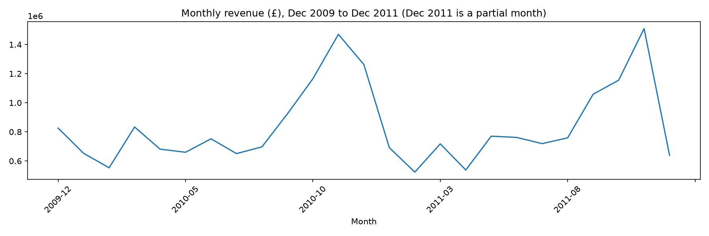
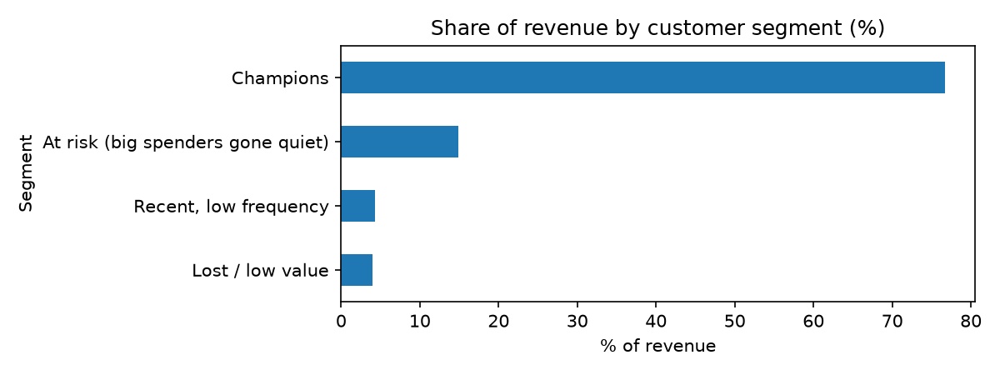

# Online Retail Customer Analysis (Python)

Which customers bring the money, who comes back, and who is slipping away? An analysis of two years of sales from a UK online gift-ware retailer, using Python (pandas) and RFM customer segmentation.

## Key findings

- **1,041,670 valid sales lines, about £20.97M revenue** (Dec 2009 to Dec 2011) after cleaning.
- **Sales peak in November each year:** £1.47M (Nov 2010) and £1.51M (Nov 2011). This is probably gift buying ahead of Christmas, including wholesalers stocking up early.
- **72.4% of identified customers ordered more than once** (4,255 of 5,878). The retailer has many wholesale customers, so this is far higher than a typical one-off consumer shop.
- **The top 10% of customers (587) bring 63.9% of revenue** from identified customers, so the business depends on a small group.
- **RFM segments:** 2,059 "Champions" bring 76.7% of revenue. 919 "at risk" customers (big spenders who went quiet) are worth about £2.6M (14.9%).

## Recommendations

1. Look after the Champions, because losing a few would cut revenue sharply.
2. Contact the 919 "at risk" customers with an offer **before the November rush**, since they are worth about £2.6M and are cheaper to win back than finding new customers.

## How it was built

1. Loaded both yearly sheets of the Excel file and combined them (1,067,371 rows).
2. Created a Revenue column (Quantity x Price) and checked for missing values.
3. Cleaned the data: removed cancelled invoices (invoice numbers starting with "C"), rows with zero or negative quantity, and rows with zero or negative price (25,701 rows).
4. Kept **two views**: all cleaned rows for sales totals, and only rows with a Customer ID for customer analysis.
5. Grouped revenue by month, counted orders per customer, and measured revenue concentration.
6. Built **RFM** (Recency, Frequency, Monetary) scores from 1 to 4 per customer using quartiles, then grouped customers into four segments with simple rules.

Code and charts are in [`online_retail_analysis.ipynb`](online_retail_analysis.ipynb).

## Data notes and limitations

- About 22.8% of rows have no Customer ID. They count in sales totals but are **excluded from customer analysis**, because we can't tell who bought.
- Cancelled orders and returns were **removed**, not netted off, so revenue is gross of returns.
- **December 2011 is a partial month** (data ends 9 December 2011), so it is not a real drop.
- RFM scores are relative (quartiles), and the segment rules are a simple choice, not a fixed standard.
- The Christmas explanation is a likely reason, not something this data proves.

## Tools

Python, pandas, matplotlib, Jupyter Notebook.

## Dataset

[UCI Machine Learning Repository: Online Retail II](https://archive.ics.uci.edu/dataset/502/online+retail+ii) (Daqing Chen), CC BY 4.0. The file is not included here because of its size. Download it and place `online_retail_II.xlsx` next to the notebook to run it.
